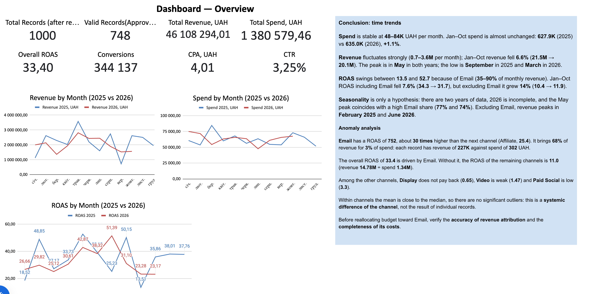
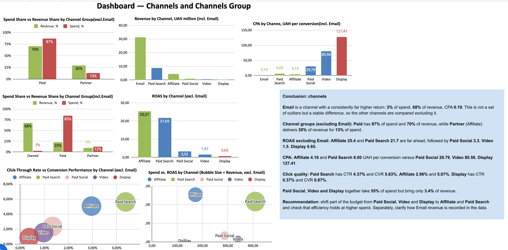
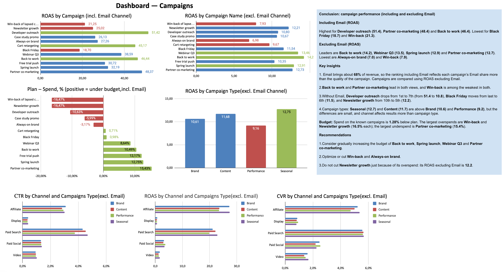
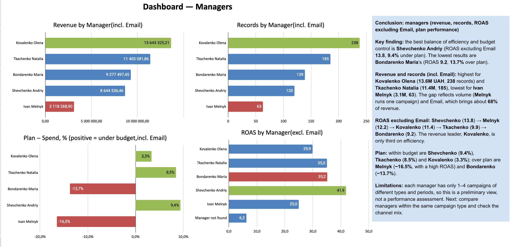
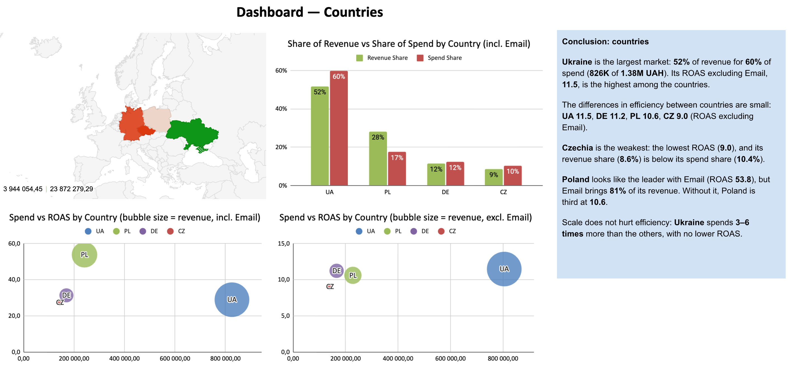
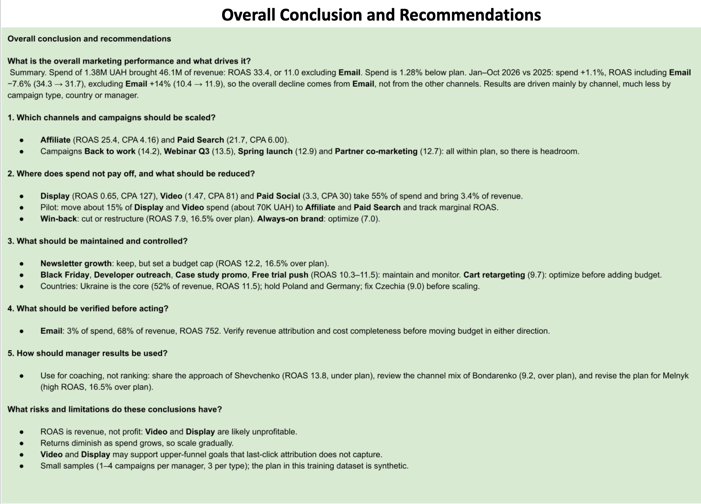

🇬🇧 English | 🇺🇦 [Українська](./README.uk.md)

# Marketing Campaign Effectiveness: Google Sheets Analytics Case

An end-to-end analysis in Google Sheets: raw, messy campaign data → cleaned dataset → pivot calculations → five dashboards → an executive conclusion with budget recommendations.

> **Data note.** This is a practice dataset (1,000 records, 2025–2026). It was generated for training, and the `planned_budget` values are synthetic. The case demonstrates a method and a way of thinking; the figures do not describe a real company.

**Files:** [`data/`](./data) (workbook in English and English/Ukrainian) · [`dashboards/`](./dashboards) (screenshots and PDF)

---

## 1. Business problem

**Context.** Over 2025–2026 a company invested in six advertising channels (Email, Paid Search, Paid Social, Affiliate, Video, Display) and twelve campaigns. Next year's budget is being planned, but it is unclear which channels and campaigns actually pay off.

**Stakeholder.** Head of Marketing. **My role:** analyst preparing a dashboard and a conclusion to support the budget decision.

**Goal.** Find out where marketing spend brings revenue and where it does not, and recommend how to reallocate the budget.

**Questions**
1. What is the overall performance: spend, revenue, ROAS, CPA, CTR?
2. How do spend and revenue change by month?
3. Which channels pay off (ROAS > 1) and which do not?
4. Which campaigns are the most profitable, and which exceed their planned budget?
5. Are there anomalies that distort the conclusions?

Extra questions I added: which managers deliver efficiently within budget, which countries perform best, and whether campaign type matters.

**Rules.** Only records with status *Approved* and a date no later than 31.10.2026 are counted as valid. ROAS = revenue ÷ spend, CPA = spend ÷ conversions, CTR = clicks ÷ impressions, CVR = conversions ÷ clicks.

---

## 2. Workbook structure

| Sheet | Purpose |
|---|---|
| `Overall conclusion and recommendations` | Executive summary: what to scale, reduce, keep and verify |
| `1. Dashboard — Overview` | KPI cards, monthly revenue, spend and ROAS (2025 vs 2026) |
| `2. Dashboard — Channels` | Channel and channel-group shares, ROAS, CPA, CTR/CVR |
| `3. Dashboard — Campaigns` | ROAS by campaign and type, plan vs spend, channel × type |
| `4. Dashboard — Managers` | Revenue, records, ROAS and plan performance by manager |
| `5. Dashboard — Countries` | Revenue and spend share, ROAS by country, map |
| `Calculations` | Pivot tables and metric formulas behind every chart |
| `Raw Campaign_data` | Original data (1,015 rows) |
| `Cleaned Campaign_data` | Cleaned data (1,000 rows) with helper columns; formulas are documented in cell comments |
| `R Campaigns`, `R Channels`, `R Managers` | Raw reference tables |
| `C Campaigns`, `C Channels`, `C Managers` | Cleaned reference tables (used by lookups) |

---

### Dashboards








Full PDF: [marketing_campaigns.pdf](./dashboards/marketing_campaigns.pdf)

---

## 3. Data cleaning

The raw table (1,015 rows) had typical quality problems. After cleaning, 1,000 unique records remained.

| Problem in raw data | Scale | Fix |
|---|---|---|
| Duplicate `record_id` | 15 rows | Highlighted with conditional formatting, then removed (checked with `COUNTA` − `COUNTUNIQUE`) |
| Dates stored as text | 132 rows | `DATEVALUE(TRIM())` |
| `spend` / `revenue` stored as text, e.g. `4332.83 UAH.` | 197 / 178 rows | Strip `UAH` and spaces, replace `.` with `,` and convert with `VALUE` |
| `impressions` with spaces as thousands separators | 59 rows | `VALUE(SUBSTITUTE(...; " "; ""))` |
| Inconsistent `channel` spelling (`display`, `Paid-Search`, `EMAIL`, trailing spaces) | many | `PROPER(TRIM(SUBSTITUTE(...)))` |
| Inconsistent `status` (`approved`, `APPROVED`, `Approved `) | many | `PROPER(SUBSTITUTE(...))` |
| Unknown campaign slug (`summer-sale`) | 3 rows | Flagged as `Campaign not found` / `Manager not found` (kept visible, not silently dropped) |
| Managers: mixed case and word order, phone formats, 2 missing emails, text dates | reference table | `PROPER(TRIM())`, `REGEXREPLACE`, `IF(LEN()=0; "Missed Email"; ...)` |

### Formulas used

> Cell references in the formulas below follow the layout of my working sheet; the pattern matters, so adjust the references to your own columns. Semicolons are the argument separator of my locale (use commas in English-locale spreadsheets).

**`Cleaned Campaign_data`**

| Column | Formula |
|---|---|
| `date` | `=DATEVALUE(TRIM(B2))` |
| `tracking_code2` | `=UPPER(TRIM(SPLIT(C2;"_";)))` |
| `channel_code` | `=UPPER(MID(TRIM(D2);7;3))` |
| `campaign_slug` | `=TRIM(RIGHT(C2;LEN(C2)-FIND("_";C2)))` |
| `country` | `=UPPER(LEFT(D2;2))` |
| `channel` | `=PROPER(TRIM(SUBSTITUTE(I2;"-";" ")))` |
| `channel_group` | `=IFERROR(VLOOKUP(E2;Channels[[channel_code]:[channel_group]];2;FALSE);"Channel group not found")` |
| `campaign_name` | `=IFERROR(VLOOKUP(F2;Campaigns[[campaign_slug]:[campaign_name]];2;FALSE);"Campaign not found")` |
| `campaign_type` | `=VLOOKUP(F2;Campaigns[[campaign_slug]:[campaign_type]];3;FALSE)` |
| `impressions` | `=VALUE(SUBSTITUTE(J2;" ";""))` |
| `spend` | `=IF(ISTEXT(L2);VALUE(SUBSTITUTE(SUBSTITUTE(SUBSTITUTE(SUBSTITUTE(L2;"UAH.";"");"UAH";"");" ";"");".";","));L2)` |
| `revenue` | same pattern as `spend` |
| `status` | `=PROPER(SUBSTITUTE(O2;" ";""))` |
| `manager_name` | `=IFERROR(VLOOKUP(F2;Campaigns[[campaign_slug]:[manager_name]];5;FALSE);"Manager not found")` |
| `valid` | `=IF(AND(Q2="Approved";B2<=DATE(2026;10;31));"Valid";"Not Valid")` |
| duplicate check | `=COUNTA(A:A)-COUNTUNIQUE(A:A)` |

**`C Campaigns`**

| Column | Formula |
|---|---|
| `campaign_slug` | `=LOWER(TRIM(A2))` |
| `campaign_name` | `=TRIM(B2)` |
| `campaign_type`, `manager_id` | `=PROPER(TRIM(C2))` |
| `manager_name` | `=IFERROR(VLOOKUP(D2;Managers[[manager_id]:[full_name]];2;FALSE);"Manager not found")` |
| `start_date` | `=IF(ISTEXT(E2);DATEVALUE(TRIM(E2));E2)` |
| `end_date` | `=IFERROR(EOMONTH(F2;G2-1);"Campaign not found")` |
| `completed_active` | `=IF(H2<TODAY();"Completed";"Active")` |
| `planned_budget` | `=VALUE(SUBSTITUTE(G2;" ";""))` |

**`C Managers`**

| Column | Formula |
|---|---|
| `full_name` | `=PROPER(TRIM(B2))` |
| `hire_date` | `=IF(ISTEXT(C2);DATEVALUE(TRIM(C2));C2)` |
| `email` | `=IF(LEN(D2)=0;"Missed Email";D2)` |
| `phone` | `="0"&RIGHT(REGEXREPLACE(E2;"\D";"");9)` |

### Planned budget in a record-level table

`planned_budget` belongs to a campaign, not to a record, so summing it over rows would count it many times. The plan is therefore placed **once per campaign**, on its first valid row, and zero on all other rows:

```
=IF(AND(S2="Valid";COUNTIFS($F$2:F2;F2;$S$2:S2;"Valid")=1);
    IFERROR(VLOOKUP(LOWER(TRIM(F2));Campaigns[[campaign_slug]:[planned_budget]];7;FALSE);0);0)
```

Because the plan is attached to a row, it must not be used in pivots that filter or split by channel (the row carrying the plan can be filtered out). Budget analysis uses a campaign-level view without channel filters.

---

## 4. Metrics

| Metric | Definition |
|---|---|
| ROAS | `SUM(revenue) / SUM(spend)`, computed from sums in pivots, never averaged from row ratios |
| ROAS excluding Email | The same ratio computed on data with the Email channel excluded (sums of revenue and spend without Email rows) |
| CPA | `SUM(spend) / SUM(conversions)` |
| CTR | `SUM(clicks) / SUM(impressions)` |
| CVR | `SUM(conversions) / SUM(clicks)` |
| Budget variance | `(plan − spend) / plan`; positive means under budget |

Ratios are protected from division by zero with `IFERROR(...; 0)`.

---

## 5. Analysis approach

- **Pivot tables** in `Calculations` feed every chart; the raw table stays unfiltered and valid/not valid is handled with the `valid` flag.
- **Email is analysed separately.** It brings 68% of revenue for 3% of spend (ROAS ≈ 752), so any comparison of channels, campaigns, managers or countries that includes it mostly reflects each item's Email share. All rankings are therefore shown including and excluding Email.
- **Anomaly check.** Mean vs median per channel (impressions, clicks, spend, revenue) shows no significant outliers inside channels, so the Email effect is a systemic difference, not a few bad rows.
- **Reconciliation.** Totals tie out across sheets: valid records 748, spend 1,380,579, revenue 46,108,294, and the planned budget of all 12 campaigns sums to 1,395,000.

---

## 6. Key findings

| Area | Finding |
|---|---|
| Overall | Spend 1.38M UAH, revenue 46.1M, ROAS 33.4 (11.0 excluding Email), CPA 4.01, CTR 3.25%. Spend is 1.28% below plan (known campaigns). |
| Time | Spend is stable (≈48–84K per month). Jan–Oct 2026 vs 2025: spend +1.1%, ROAS −7.6% with Email, +14% without. The decline comes from Email, not from the other channels. |
| Channels | Affiliate (ROAS 25.4) and Paid Search (21.7) pay off clearly; Paid Social (3.3) and Video (1.5) are weak; Display (0.65) does not pay off. Paid Social, Video and Display take 55% of spend and bring 3.4% of revenue. |
| Campaigns | Best (excluding Email): Back to work 14.2, Webinar Q3 13.5, Spring launch 12.9, Partner co-marketing 12.7. Weakest: Always-on brand 7.0, Win-back 7.9. Win-back and Newsletter growth exceed plan by 16.5%. |
| Campaign type | Seasonal 12.7, Content 11.7, Brand 10.6, Performance 9.2. Differences are small; channel matters more than campaign type. |
| Managers | Shevchenko has the best balance (ROAS 13.8, under plan); Bondarenko the weakest (9.2, over plan). Each manager has only 1–4 campaigns, so this is a preliminary view. |
| Countries | Ukraine: 52% of revenue, ROAS 11.5. Differences between countries are small; Czechia is weakest (9.0). |
| Anomalies | Email (3% of spend, 68% of revenue, CPA 0.19) is a systemic outlier; its revenue attribution should be verified. |

---

## 7. Recommendations

1. **Scale:** Affiliate, Paid Search, and the campaigns Back to work, Webinar Q3, Spring launch and Partner co-marketing (all within plan).
2. **Reduce:** Display, Video and Paid Social. Pilot: move ≈15% of Display and Video spend (≈70K UAH) to Affiliate and Paid Search and track marginal ROAS. Cut or restructure Win-back; optimize Always-on brand.
3. **Maintain and control:** Newsletter growth (cap the budget), Black Friday, Developer outreach, Case study promo, Free trial push. Optimize Cart retargeting before adding budget. Fix Czechia before scaling it.
4. **Verify before acting:** Email revenue attribution and cost completeness.
5. **Managers:** use the results for coaching, not ranking.

---

## 8. Limitations

- ROAS is revenue, not profit: Video and Display are likely unprofitable once margin is considered.
- Returns diminish as spend grows, so scaling should be gradual and tested.
- Video and Display may support upper-funnel goals that last-click attribution does not capture.
- Small samples: 1–4 campaigns per manager, 3 per campaign type; 2026 is incomplete (January–October).
- The plan is synthetic in this practice dataset. Seasonality is only a hypothesis: the May peak coincides with a high Email share.

---

## 9. Skills demonstrated

Data cleaning with text, date and lookup formulas (`TRIM`, `PROPER`, `SUBSTITUTE`, `REGEXREPLACE`, `DATEVALUE`, `VALUE`, `VLOOKUP`, `IFERROR`, `COUNTIFS`, `EOMONTH`); duplicate detection with conditional formatting; pivot tables with calculated fields; KPI design (ROAS, CPA, CTR, CVR, budget variance); anomaly analysis; chart selection (bar, bubble, map, combo); dashboard layout; business storytelling and recommendations.

---

*Tools: Google Sheets (formulas, pivot tables, charts, geo map), Looker Studio (dashboard visualization).*
