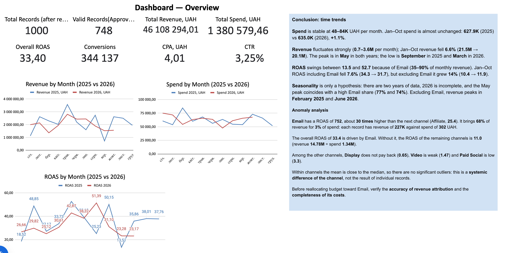
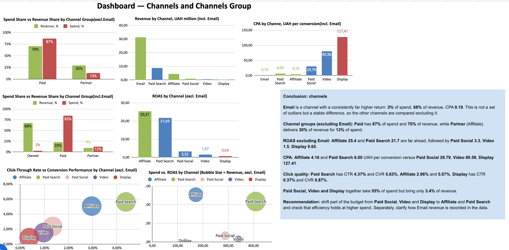
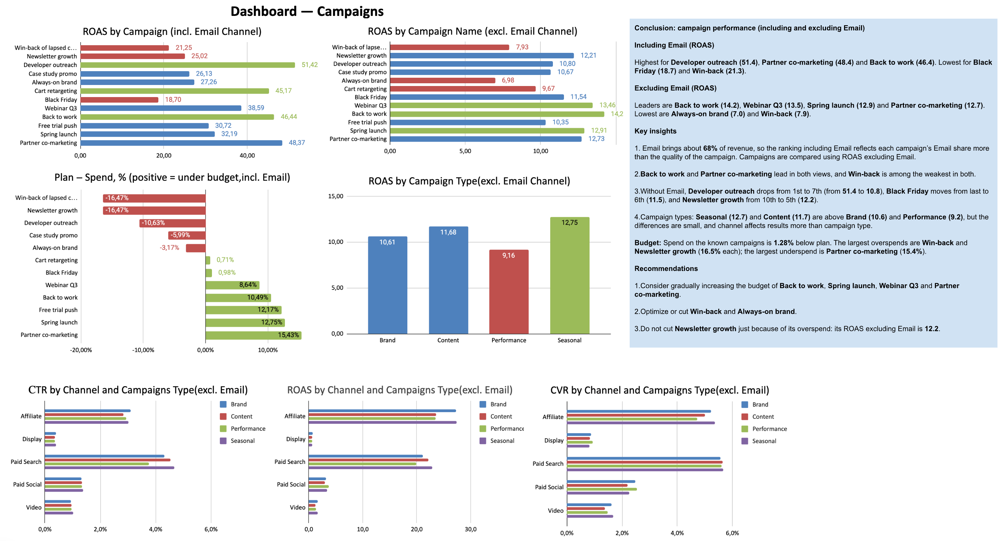
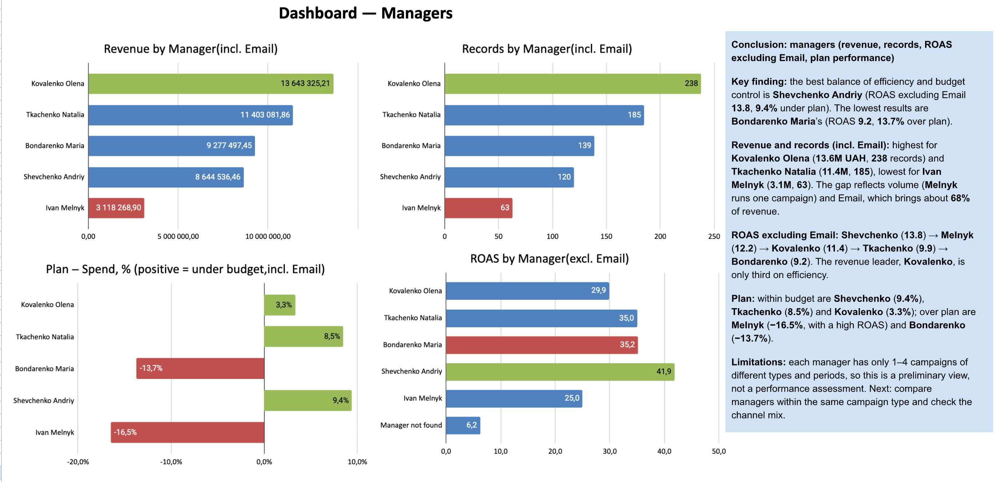
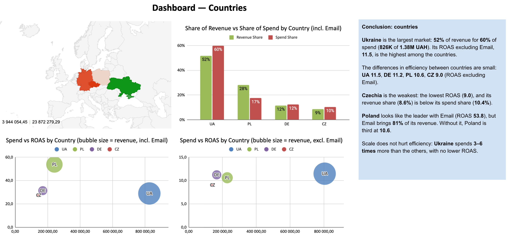
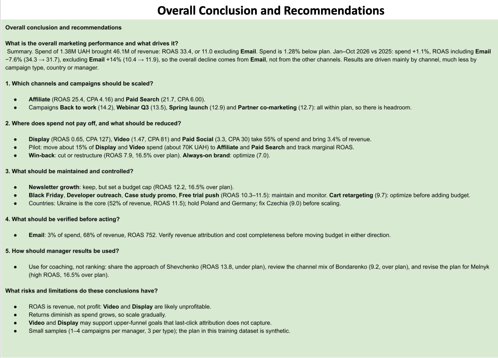

🇬🇧 [English](./README.md) | 🇺🇦 Українська

# Ефективність маркетингових кампаній: аналітичний кейс у Google Sheets

Наскрізний аналіз у Google Sheets: «брудні» сирі дані кампаній → очищений датасет → зведені розрахунки → п'ять дашбордів → підсумковий висновок з рекомендаціями щодо бюджету.

> **Примітка щодо даних.** Це навчальний датасет (1 000 записів, 2025–2026). Його згенеровано для практики, а значення `planned_budget` синтетичні. Кейс демонструє метод і підхід до мислення; цифри не описують реальну компанію.

**Файли:** [`data/`](./data) (книга англійською та англійською/українською) · [`dashboards/`](./dashboards) (скриншоти та PDF)

---

## 1. Бізнес-задача

**Контекст.** Протягом 2025–2026 компанія інвестувала в шість рекламних каналів (Email, Paid Search, Paid Social, Affiliate, Video, Display) і дванадцять кампаній. Планується бюджет на наступний рік, але незрозуміло, які канали та кампанії справді окупаються.

**Стейкхолдер.** Керівник маркетингу. **Моя роль:** аналітик, який готує дашборд і висновок для підтримки рішення щодо бюджету.

**Мета.** З'ясувати, де маркетингові витрати приносять дохід, а де ні, і порекомендувати, як перерозподілити бюджет.

**Питання**
1. Яка загальна ефективність: витрати, дохід, ROAS, CPA, CTR?
2. Як змінюються витрати та дохід по місяцях?
3. Які канали окупаються (ROAS > 1), а які ні?
4. Які кампанії найприбутковіші і які перевищують плановий бюджет?
5. Чи є аномалії, що спотворюють висновки?

Додаткові питання, які я додала: які менеджери працюють ефективно в межах бюджету, які країни показують найкращі результати та чи має значення тип кампанії.

**Правила.** Валідними вважаються лише записи зі статусом *Approved* і датою не пізніше 31.10.2026. ROAS = дохід ÷ витрати, CPA = витрати ÷ конверсії, CTR = кліки ÷ покази, CVR = конверсії ÷ кліки.

---

## 2. Структура книги

| Аркуш | Призначення |
|---|---|
| `Overall conclusion and recommendations` | Підсумок для керівництва: що масштабувати, скоротити, зберегти та перевірити |
| `1. Dashboard — Overview` | KPI-картки, дохід, витрати та ROAS по місяцях (2025 vs 2026) |
| `2. Dashboard — Channels` | Частки каналів і груп каналів, ROAS, CPA, CTR/CVR |
| `3. Dashboard — Campaigns` | ROAS за кампаніями та типами, план vs факт, канал × тип |
| `4. Dashboard — Managers` | Дохід, кількість записів, ROAS і виконання плану за менеджерами |
| `5. Dashboard — Countries` | Частки доходу та витрат, ROAS за країнами, карта |
| `Calculations` | Зведені таблиці та формули метрик за кожним графіком |
| `Raw Campaign_data` | Вихідні дані (1 015 рядків) |
| `Cleaned Campaign_data` | Очищені дані (1 000 рядків) із допоміжними стовпцями; формули описані в коментарях до клітинок |
| `R Campaigns`, `R Channels`, `R Managers` | Сирі довідкові таблиці |
| `C Campaigns`, `C Channels`, `C Managers` | Очищені довідкові таблиці (використовуються у пошуку) |

### Дашборди








Повний PDF: [marketing_campaigns.pdf](./dashboards/marketing_campaigns.pdf)

---

## 3. Очищення даних

Сира таблиця (1 015 рядків) мала типові проблеми якості. Після очищення залишилося 1 000 унікальних записів.

| Проблема в сирих даних | Масштаб | Виправлення |
|---|---|---|
| Дублікати `record_id` | 15 рядків | Підсвічено умовним форматуванням, потім видалено (перевірка `COUNTA` − `COUNTUNIQUE`) |
| Дати збережені як текст | 132 рядки | `DATEVALUE(TRIM())` |
| `spend` / `revenue` збережені як текст, напр. `4332.83 UAH.` | 197 / 178 рядків | Прибрати `UAH` і пробіли, замінити `.` на `,` та перетворити через `VALUE` |
| `impressions` з пробілами як роздільниками тисяч | 59 рядків | `VALUE(SUBSTITUTE(...; " "; ""))` |
| Неоднакове написання `channel` (`display`, `Paid-Search`, `EMAIL`, кінцеві пробіли) | багато | `PROPER(TRIM(SUBSTITUTE(...)))` |
| Неоднаковий `status` (`approved`, `APPROVED`, `Approved `) | багато | `PROPER(SUBSTITUTE(...))` |
| Невідомий slug кампанії (`summer-sale`) | 3 рядки | Позначено як `Campaign not found` / `Manager not found` (залишено видимими, не відкинуто мовчки) |
| Менеджери: змішаний регістр і порядок слів, формати телефонів, 2 відсутні email, дати текстом | довідкова таблиця | `PROPER(TRIM())`, `REGEXREPLACE`, `IF(LEN()=0; "Missed Email"; ...)` |

### Використані формули

> Посилання на клітинки у формулах нижче відповідають розкладці мого робочого аркуша; важливий сам патерн, тож підлаштуйте посилання під свої стовпці. Крапка з комою — роздільник аргументів моєї локалі (в англомовних таблицях використовуйте коми).

**`Cleaned Campaign_data`**

| Стовпець | Формула |
|---|---|
| `date` | `=DATEVALUE(TRIM(B2))` |
| `tracking_code2` | `=UPPER(TRIM(SPLIT(C2;"_";)))` |
| `channel_code` | `=UPPER(MID(TRIM(D2);7;3))` |
| `campaign_slug` | `=TRIM(RIGHT(C2;LEN(C2)-FIND("_";C2)))` |
| `country` | `=UPPER(LEFT(D2;2))` |
| `channel` | `=PROPER(TRIM(SUBSTITUTE(I2;"-";" ")))` |
| `channel_group` | `=IFERROR(VLOOKUP(E2;Channels[[channel_code]:[channel_group]];2;FALSE);"Channel group not found")` |
| `campaign_name` | `=IFERROR(VLOOKUP(F2;Campaigns[[campaign_slug]:[campaign_name]];2;FALSE);"Campaign not found")` |
| `campaign_type` | `=VLOOKUP(F2;Campaigns[[campaign_slug]:[campaign_type]];3;FALSE)` |
| `impressions` | `=VALUE(SUBSTITUTE(J2;" ";""))` |
| `spend` | `=IF(ISTEXT(L2);VALUE(SUBSTITUTE(SUBSTITUTE(SUBSTITUTE(SUBSTITUTE(L2;"UAH.";"");"UAH";"");" ";"");".";","));L2)` |
| `revenue` | той самий патерн, що й `spend` |
| `status` | `=PROPER(SUBSTITUTE(O2;" ";""))` |
| `manager_name` | `=IFERROR(VLOOKUP(F2;Campaigns[[campaign_slug]:[manager_name]];5;FALSE);"Manager not found")` |
| `valid` | `=IF(AND(Q2="Approved";B2<=DATE(2026;10;31));"Valid";"Not Valid")` |
| перевірка дублікатів | `=COUNTA(A:A)-COUNTUNIQUE(A:A)` |

**`C Campaigns`**

| Стовпець | Формула |
|---|---|
| `campaign_slug` | `=LOWER(TRIM(A2))` |
| `campaign_name` | `=TRIM(B2)` |
| `campaign_type`, `manager_id` | `=PROPER(TRIM(C2))` |
| `manager_name` | `=IFERROR(VLOOKUP(D2;Managers[[manager_id]:[full_name]];2;FALSE);"Manager not found")` |
| `start_date` | `=IF(ISTEXT(E2);DATEVALUE(TRIM(E2));E2)` |
| `end_date` | `=IFERROR(EOMONTH(F2;G2-1);"Campaign not found")` |
| `completed_active` | `=IF(H2<TODAY();"Completed";"Active")` |
| `planned_budget` | `=VALUE(SUBSTITUTE(G2;" ";""))` |

**`C Managers`**

| Стовпець | Формула |
|---|---|
| `full_name` | `=PROPER(TRIM(B2))` |
| `hire_date` | `=IF(ISTEXT(C2);DATEVALUE(TRIM(C2));C2)` |
| `email` | `=IF(LEN(D2)=0;"Missed Email";D2)` |
| `phone` | `="0"&RIGHT(REGEXREPLACE(E2;"\D";"");9)` |

### Плановий бюджет у таблиці на рівні записів

`planned_budget` належить кампанії, а не запису, тому сумування по рядках враховувало б його багато разів. Тому план проставляється **один раз на кампанію**, у її першому валідному рядку, а в усіх інших рядках дорівнює нулю:

```
=IF(AND(S2="Valid";COUNTIFS($F$2:F2;F2;$S$2:S2;"Valid")=1);
    IFERROR(VLOOKUP(LOWER(TRIM(F2));Campaigns[[campaign_slug]:[planned_budget]];7;FALSE);0);0)
```

Оскільки план прив'язаний до рядка, його не можна використовувати у зведених таблицях, що фільтрують або розбивають за каналом (рядок із планом може бути відфільтрований). Аналіз бюджету використовує вигляд на рівні кампаній без фільтрів за каналами.

---

## 4. Метрики

| Метрика | Визначення |
|---|---|
| ROAS | `SUM(revenue) / SUM(spend)`, рахується із сум у зведених таблицях, ніколи не усереднюється з рядкових відношень |
| ROAS без Email | Те саме відношення на даних без каналу Email (суми доходу та витрат без рядків Email) |
| CPA | `SUM(spend) / SUM(conversions)` |
| CTR | `SUM(clicks) / SUM(impressions)` |
| CVR | `SUM(conversions) / SUM(clicks)` |
| Відхилення від бюджету | `(план − витрати) / план`; додатне значення означає економію |

Відношення захищені від ділення на нуль через `IFERROR(...; 0)`.

---

## 5. Підхід до аналізу

- **Зведені таблиці** в `Calculations` живлять кожен графік; сира таблиця лишається без фільтрів, а валідність/невалідність обробляється прапорцем `valid`.
- **Email аналізується окремо.** Він приносить 68% доходу при 3% витрат (ROAS ≈ 752), тому будь-яке порівняння каналів, кампаній, менеджерів чи країн із ним здебільшого відображає частку Email у кожного. Тому всі рейтинги показано з Email і без нього.
- **Перевірка аномалій.** Порівняння середнього та медіани по каналах (покази, кліки, витрати, дохід) не виявляє суттєвих викидів усередині каналів, тож ефект Email — це системна різниця, а не кілька поганих рядків.
- **Звірка.** Підсумки збігаються між аркушами: валідних записів 748, витрати 1 380 579, дохід 46 108 294, а плановий бюджет усіх 12 кампаній разом становить 1 395 000.

---

## 6. Ключові висновки

| Напрям | Висновок |
|---|---|
| Загалом | Витрати 1,38 млн грн, дохід 46,1 млн, ROAS 33,4 (11,0 без Email), CPA 4,01, CTR 3,25%. Витрати на 1,28% нижчі за план (відомі кампанії). |
| Час | Витрати стабільні (≈48–84 тис. на місяць). Січень–жовтень 2026 vs 2025: витрати +1,1%, ROAS −7,6% з Email, +14% без нього. Спад зумовлений Email, а не іншими каналами. |
| Канали | Affiliate (ROAS 25,4) і Paid Search (21,7) явно окупаються; Paid Social (3,3) і Video (1,5) слабкі; Display (0,65) не окупається. Paid Social, Video і Display забирають 55% витрат і приносять 3,4% доходу. |
| Кампанії | Найкращі (без Email): Back to work 14,2, Webinar Q3 13,5, Spring launch 12,9, Partner co-marketing 12,7. Найслабші: Always-on brand 7,0, Win-back 7,9. Win-back і Newsletter growth перевищують план на 16,5%. |
| Тип кампанії | Seasonal 12,7, Content 11,7, Brand 10,6, Performance 9,2. Різниця невелика; канал важить більше за тип кампанії. |
| Менеджери | Shevchenko має найкращий баланс (ROAS 13,8, у межах плану); Bondarenko — найслабший (9,2, перевищення плану). У кожного менеджера лише 1–4 кампанії, тож це попередня оцінка. |
| Країни | Україна: 52% доходу, ROAS 11,5. Різниця між країнами невелика; Чехія найслабша (9,0). |
| Аномалії | Email (3% витрат, 68% доходу, CPA 0,19) — системний викид; атрибуцію його доходу слід перевірити. |

---

## 7. Рекомендації

1. **Масштабувати:** Affiliate, Paid Search та кампанії Back to work, Webinar Q3, Spring launch і Partner co-marketing (усі в межах плану).
2. **Скоротити:** Display, Video і Paid Social. Пілот: перенести ≈15% витрат на Display і Video (≈70 тис. грн) в Affiliate і Paid Search та відстежувати граничний ROAS. Скоротити або перебудувати Win-back; оптимізувати Always-on brand.
3. **Зберігати й контролювати:** Newsletter growth (обмежити бюджет), Black Friday, Developer outreach, Case study promo, Free trial push. Оптимізувати Cart retargeting до збільшення бюджету. Виправити Чехію до масштабування.
4. **Перевірити перед дією:** атрибуцію доходу Email і повноту витрат.
5. **Менеджери:** використовувати результати для коучингу, а не для рейтингу.

---

## 8. Обмеження

- ROAS — це дохід, а не прибуток: Video і Display, імовірно, збиткові з урахуванням маржі.
- Віддача спадає зі зростанням витрат, тому масштабувати слід поступово й з тестами.
- Video і Display можуть працювати на цілі верхньої частини воронки, які last-click атрибуція не фіксує.
- Малі вибірки: 1–4 кампанії на менеджера, 3 на тип кампанії; 2026 рік неповний (січень–жовтень).
- План у цьому навчальному датасеті синтетичний. Сезонність — лише гіпотеза: травневий пік збігається з високою часткою Email.

---

## 9. Продемонстровані навички

Очищення даних за допомогою текстових, датових формул і формул пошуку (`TRIM`, `PROPER`, `SUBSTITUTE`, `REGEXREPLACE`, `DATEVALUE`, `VALUE`, `VLOOKUP`, `IFERROR`, `COUNTIFS`, `EOMONTH`); пошук дублікатів за допомогою умовного форматування; зведені таблиці з обчислюваними полями; проєктування KPI (ROAS, CPA, CTR, CVR, відхилення від бюджету); аналіз аномалій; вибір типу графіка (стовпчиковий, бульбашковий, карта, комбінований); компонування дашбордів; бізнес-сторітелінг і рекомендації.

---

*Інструменти: Google Sheets (формули, зведені таблиці, графіки, геокарта), Looker Studio (візуалізація дашбордів).*
